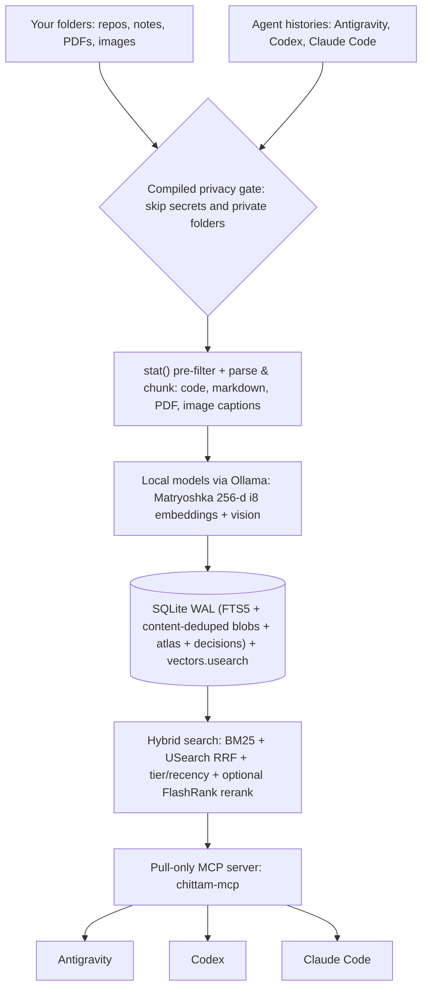

# Chittam (चित्तम्)

**One local memory for all your AI coding agents.**

Chittam indexes your repositories, notes, PDFs, screenshots, and past agent conversations **on your own machine**, then lets Antigravity, Codex, and Claude Code search all of it through one MCP server. Nothing leaves your computer unless you explicitly opt in.

[](LICENSE)
[](pyproject.toml)
[](https://modelcontextprotocol.io)
[](docs/ARCHITECTURE.md#5-privacy-gate)

> *Chittam* (Sanskrit *citta*) is the part of the mind that stores impressions and memories.

---

## The problem

If you use more than one AI coding agent, you have probably hit these:

| Problem | What it looks like |
| :--- | :--- |
| **Agents forget** | Yesterday you designed something with Claude Code. Today Codex has no idea it happened. |
| **Stale copies win** | You have `my-app`, `my-app-old`, and `my-app-backup`. The agent reads the wrong one. |
| **`grep` is not enough** | "Where did we handle login retries?" has no exact keyword to search for. |
| **Images are invisible** | Architecture diagrams and UI screenshots hold answers no text search can see. |
| **Memory tools leak or bloat** | Auto-injected memory breaks prompt caching, and naive indexers happily index `.env` files. |

## What Chittam does

1. **Scans** the folders you choose (with a fast `stat()` pre-filter and real-time `chittam watch`), plus your Antigravity, Codex, and Claude Code histories.
2. **Blocks** secrets and private folders *before* reading them (`.env`, keys, tax folders, credential files).
3. **Understands** text, code, PDFs, images, and decisions using local models through [Ollama](https://ollama.com).
4. **Indexes cleanly at scale** using **USearch HNSW** with Matryoshka **256-d `i8` quantization** (~12x smaller than 768-d `float32`), **content-hash deduplication** across cloned repos, and **tiered embedding** (`active`/`reference` vectorized; `archive` stays fast BM25-only by default).
5. **Ranks** active projects above old copies, supports optional local ONNX cross-encoder reranking (`chittam[rerank]`), and serves compact results over pull-only MCP so prompt caches stay intact.



More detail: [docs/ARCHITECTURE.md](docs/ARCHITECTURE.md).

## Built on existing tools, not a rewrite

Chittam doesn't rebuild what already works well. It connects existing tools and fills the gaps between them.

| Tool | What it's great at | Where Chittam fits |
| :--- | :--- | :--- |
| [`ripgrep`](https://github.com/BurntSushi/ripgrep) | Exact matches in the current repo | Agents keep using it for known symbols |
| [CodeGraph](https://github.com/colbymchenry/codegraph) | Call graphs and symbol relationships | Installed alongside Chittam as a second MCP server |
| [USearch](https://github.com/unum-cloud/usearch) | Fast, single-file `i8` HNSW ANN index | Built-in default vector index (`vectors.usearch`), rebuildable offline from SQLite |
| [LEANN](https://github.com/StarTrail-org/LEANN) | Ultra-compact graph-recomputed indexes | Optional export target (`chittam sync --leann-export`) |
| [qmd](https://github.com/tobi/qmd) | Hybrid search over markdown notes | Same hybrid idea, extended to code, images, and agent threads |
| [claude-mem](https://github.com/thedotmack/claude-mem) | Automatic session memory | Chittam is pull-only, so it never rewrites your prompt |

What Chittam adds: **cross-agent recall**, **active-vs-archived project ranking**, **image and PDF understanding**, **semantic decision history**, **deduped quantized ANN search**, and a **strict privacy gate** in one local stack.

---

## Quick start (about 5 minutes)

**Requirements:** macOS or Linux, Python 3.11+, [uv](https://docs.astral.sh/uv/), [Ollama](https://ollama.com). Any Apple Silicon Mac or a machine with about 8 GB of free RAM works.

```bash
# 1. Install (add `--extra rerank` for optional local ONNX cross-encoder reranking)
git clone https://github.com/VAMFI/chittam.git
cd chittam
uv sync
# optional: uv sync --extra rerank

# 2. Pull the local models (about 2.5 GB total)
ollama pull embeddinggemma:latest   # text embeddings (Matryoshka 256-d i8 by default)
ollama pull qwen3-vl:2b             # image understanding

# 3. Check everything works, without touching your files
uv run chittam benchmark --synthetic

# 4. Create your config, then edit which folders to scan
uv run chittam init
#    -> ~/.config/chittam/config.yaml   (see docs/HOW_TO.md#2)

# 5. Build the index & verify health
uv run chittam sync
uv run chittam doctor
```

**Connect your agents and keep the index fresh** (backs up every config file first):

```bash
uv run chittam install-harnesses   # Antigravity + Codex + Claude Code
uv run chittam watch               # real-time FSEvents/inotify incremental sync
uv run chittam install-launchd     # macOS: periodic safety-net sync every 30 minutes
```

Undo at any time with `uv run chittam uninstall-harnesses` and `uv run chittam uninstall-launchd`.

Optional companions:

```bash
npm install -g @colbymchenry/codegraph        # structural code graph MCP
uv tool install leann-core --with leann       # compact vector index export
```

---

## Commands

| Command | What it does |
| :--- | :--- |
| `chittam init` | Create config, database, and project atlas |
| `chittam atlas [--refresh]` | List discovered git repos and their tier |
| `chittam sync` | Incremental `stat()` + Merkle sync and deduped vector embeddings |
| `chittam watch` | Watch configured folders and harness histories in real time |
| `chittam search "query"` | Hybrid search (`--rerank/--no-rerank`, `--media-type`, `--project`, `--harness`, `--no-archived`, `--json`) |
| `chittam decide <project> <topic> "<statement>"` | Record a decision (supersedes prior active decision on that topic; semantically indexed) |
| `chittam decisions` | List current decisions (`--all` for history) |
| `chittam status` | Index size, counts, USearch vector state, and background sync status |
| `chittam doctor` | Non-destructive diagnostics across config, SQLite/USearch parity, Ollama, TCC, and harnesses |
| `chittam compact` | Prune orphan vector blobs, compact USearch, checkpoint WAL, and `VACUUM` SQLite |
| `chittam reindex-vectors` | Rebuild `vectors.usearch` completely offline from SQLite |
| `chittam install-harnesses` / `uninstall-harnesses` | Wire or unwire MCP in all three agents |
| `chittam install-launchd` / `uninstall-launchd` | Enable or disable scheduled sync (macOS) |
| `chittam benchmark [--synthetic] [--rerank]` | Measure retrieval quality, latency, and privacy leakage |
| `chittam mcp` | Run the MCP server on stdio |

## MCP tools

| Tool | Use it when an agent needs to... |
| :--- | :--- |
| `memory_search` | Find something by meaning across code, docs, PDFs, images, threads, and decisions |
| `memory_get_chunk` | Read the full text around a search hit |
| `project_atlas` | Know which copy of a project is the current one |
| `recall_threads` | Recall what was discussed in earlier Antigravity, Codex, or Claude Code sessions |
| `record_decision` | Save an architectural decision so future sessions respect it |
| `index_status` | Check that the index and USearch vector store exist and are fresh |

Agents are told *when* to use these through a short rule: [docs/ROUTING_RULE.md](docs/ROUTING_RULE.md).

## Measured results

Reproducible on any machine with `uv run chittam benchmark --synthetic` (14 fixture documents plus 3 private files that must be blocked):

| Metric | Result (v0.2.0 USearch 256-d `i8`) |
| :--- | :--- |
| Recall@5 | **1.0** (13/13 queries) |
| MRR | **0.9385** |
| Query latency | **p50 0.42 ms / p95 0.84 ms** |
| Privacy leakage | **0** (3/3 private fixtures blocked at ingest) |

On a real developer machine (Apple M4 Pro, 24 GB) with ~31,100 documents and ~333,000 chunks, upgrading from v0.1 to v0.2 improved accuracy, speed, and footprint:

| Real-corpus metric | v0.1 (`768-d f32`, numpy) | v0.2 (`256-d i8`, USearch) | v0.2 + `--rerank` (`MiniLM-L-12`) |
| :--- | :--- | :--- | :--- |
| Recall@5 | 1.0 | **1.0** | **1.0** |
| MRR | 0.9423 | **1.0** | 0.9487 |
| Query latency (incl. Ollama query embed) | p50 436 ms / p95 3,136 ms | **p50 294 ms / p95 1,704 ms** | p50 505 ms / p95 1,501 ms |
| Privacy leakage | 0 | **0** | **0** |
| File scan over ~30.8k unchanged files | 29.3 s (Merkle read) | **2.5 s** (`stat()` + compiled policy) | — |
| Vector store size (~12.3k active/ref vectors) | ~36 MB raw f32 blobs | **4.77 MiB** (`vectors.usearch`, 10.4k unique hashes) | — |

See [the FAQ](docs/FAQ.md#how-fast-is-it) for details.

## Documentation

| Doc | For |
| :--- | :--- |
| [Architecture](docs/ARCHITECTURE.md) | How it works and why each piece exists |
| [How-to guides](docs/HOW_TO.md) | Setup, privacy config, agents, decisions, cloud opt-in, extending |
| [FAQ](docs/FAQ.md) | Plain-English answers, including limitations |
| [Routing rule](docs/ROUTING_RULE.md) | The short instruction agents follow |
| [Contributing](CONTRIBUTING.md) | Development workflow |

## License

[MIT](LICENSE) © VAMFI Inc.
