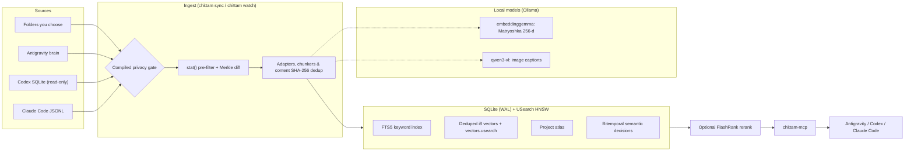
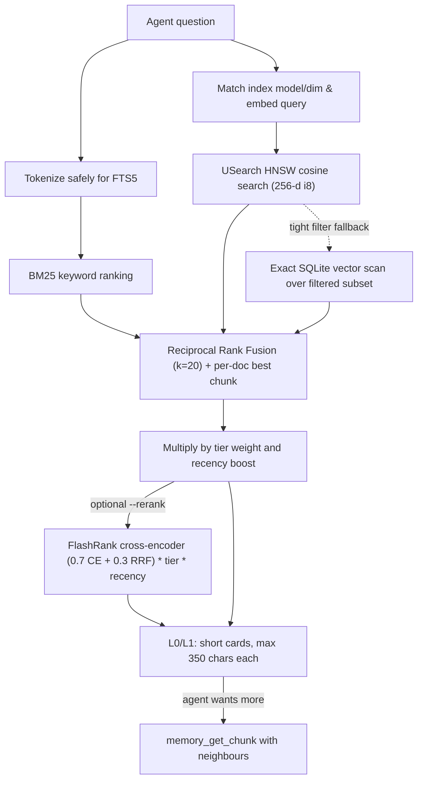

# Architecture

This page explains how Chittam works, in plain language first and then in more detail.

- [1. The five problems](#1-the-five-problems)
- [2. Big picture](#2-big-picture)
- [3. Ingestion: from files to chunks](#3-ingestion-from-files-to-chunks)
- [4. Retrieval: from a question to an answer](#4-retrieval-from-a-question-to-an-answer)
- [5. Privacy gate](#5-privacy-gate)
- [6. Canonical project atlas](#6-canonical-project-atlas)
- [7. Decision history (bitemporal)](#7-decision-history-bitemporal)
- [8. Storage layout](#8-storage-layout)
- [9. Models and providers](#9-models-and-providers)
- [10. Agent integration](#10-agent-integration)
- [11. Extending to new media types](#11-extending-to-new-media-types)
- [12. Module map](#12-module-map)
- [13. Known limits](#13-known-limits)

---

## 1. The five problems

| # | Problem | Chittam's answer |
| :- | :--- | :--- |
| 1 | **Cross-agent amnesia.** Each agent keeps its own history, so none of them knows what the others did. | Adapters read Antigravity, Codex, and Claude Code histories into one index. |
| 2 | **Multi-generation clutter.** Real machines hold `app`, `app-old`, `app-backup`, and `app-nov20`. | A project atlas classifies every repo as active, reference, or archive and ranks accordingly. |
| 3 | **Prompt-cache damage.** Memory tools that inject context on every turn change the prompt prefix and waste tokens. | Pull-only MCP: agents ask when they need something and get short summaries first. |
| 4 | **Multimodal blindness.** Diagrams, screenshots, and scanned PDFs are invisible to text search. | A local vision model captions images, so they become searchable text. |
| 5 | **Leaks.** Naive indexers read `.env` files, keys, and personal documents. | A compiled privacy gate runs *before* any file is opened, and secrets are scrubbed from text. |

## 2. Big picture



Everything runs locally. The only network calls go to Ollama on `127.0.0.1`, plus external APIs if you explicitly enable them ([section 9](#9-models-and-providers)).

## 3. Ingestion: from files to chunks

`chittam sync` and `chittam watch` share the same ingestion pipeline:

1. **Lock.** It takes an exclusive non-blocking file lock (`~/.local/share/chittam/sync.lock`). If another sync or watcher batch is already writing, a second invocation exits cleanly instead of contending on the database.
2. **Auto-migration.** If an existing database still has v0.1 `chunk_embeddings` rows (`768-d float32`), `ChittamStore` automatically Matryoshka-slices them to `256-d`, L2 re-normalizes, quantizes to `int8`, deduplicates by chunk content hash, builds `vectors.usearch`, and removes legacy blobs with zero Ollama calls.
3. **Atlas.** It loads the project atlas (or rebuilds it with `--refresh-atlas`).
4. **Collect & `stat()` pre-filter.** Each adapter produces `DocumentRecord`s:
   - `files`: walks `scan_roots` using a pre-compiled `CompiledPrivacyPolicy`. Unchanged files whose `(file_mtime_ns, file_size, canonical_tier)` match SQLite are skipped immediately at `os.DirEntry.stat()` time without opening, reading PDFs, chunking, or hashing. For the home folder itself (`~`), only top-level files are scanned when `home_top_level_files_only: true`.
   - `antigravity`: markdown artifacts and user/assistant turns from `~/.gemini/antigravity/brain/*/`.
   - `codex`: `state_5.sqlite` / `thread_history_1.sqlite` / `memories_1.sqlite`, opened read-only (`?mode=ro`) so Codex is never locked.
   - `claude_code`: `~/.claude/projects/*/*.jsonl` and `~/.claude/history.jsonl`.
5. **Chunk.** Each file type gets its own chunker:
   - **Code** splits at function and class boundaries (Python, TS/JS, Dart, Rust, Go, Shell, Kotlin/Java/Swift, Ruby, PHP), then merges small neighbours up to about 1,200 characters.
   - **Markdown and transcripts** split at headings and paragraphs.
   - **PDFs** are split per page. Pages with almost no text are marked as possibly scanned.
   - **Images** become one chunk containing the vision caption.

   Every chunk starts with a **contextual header** such as `[project | tier | path | date]` and stores a normalized `content_sha256`.
6. **Merkle diff.** Files whose `stat()` changed still compare SHA-256 + tier before touching chunks or FTS5. Documents that disappeared are pruned (decisions are preserved).
7. **Tiered, deduplicated embedding.**
   - By default, **only** chunks in `privacy.embed_tiers` (`active`, `reference`) or `privacy.embed_always_media` (`image`, `transcript`, `pdf`, `decision`) are vectorized; `archive` source/markdown repos stay fast BM25-only unless `archive` is added to `embed_tiers`.
   - Before calling Ollama, `link_deduped_embeddings()` links any chunk whose `content_sha256` already exists in `content_embeddings`, and remaining batches deduplicate identical hashes in-memory so duplicate repo clones never pay twice.
   - Recorded decisions without vectors are embedded alongside chunks.

**Budgets that keep the first run sane** (all configurable):

| Setting | Default | Why |
| :--- | :--- | :--- |
| `max_images_per_sync` | 15 | Vision captioning takes about 1 to 17 seconds per image |
| `max_embed_chunks_per_sync` | 6000 | Embedding runs at roughly 20 to 60 chunks per second on Apple Silicon |
| `max_code_files_per_repo` | 250 (15 for archived repos) | Old snapshots shouldn't dominate the index |
| `embed_tiers` | `[active, reference]` | Avoids spending compute embedding old archived clones by default |
| `max_text_file_bytes` | 512 KB | Skips generated or minified blobs |
| `max_pdf_pages` | 40 | Long PDFs are truncated |

**Real-time updates (`chittam watch`):** Uses `watchfiles` (FSEvents on macOS, inotify on Linux) with configurable debouncing (default 1500 ms), ignoring hidden/build directories (`ignore_permission_denied=True`), and calls `sync_changed_paths()` directly on changed files or harness directories.

## 4. Retrieval: from a question to an answer



- **Why hybrid?** Keyword search finds exact names (`AuthService`, an error string). Vector search finds meaning ("where do we retry logins?"). Each misses things the other catches.
- **Query-model consistency.** `build_query_embedding_provider()` reads `index_meta` (`active_embedding_source`, `active_embedding_dim`) so queries always match the exact embedding model and Matryoshka dimension used to build the index (honoring external consent flags).
- **USearch HNSW + tight-filter fallback.** Vector search queries `vectors.usearch` (`metric="cos"`, `dtype="i8"`, `expansion_search=128`) and falls back automatically to an exact quantized SQLite scan whenever a narrow filter (`media_type="image"`, `project_id=...`) matches fewer than `limit` items inside the HNSW oversample window — ensuring small subsets keep 100% vector recall.
- **Reciprocal Rank Fusion & per-doc deduplication.** Scores merge as `Σ 1/(20 + rank)`, keeping the top-scoring chunk per `doc_id` so multi-chunk files don't crowd out other results, then multiply by `tier_weight` (`active: 1.0`, `reference: 0.65`, `archive: 0.25`) and `recency` (`1 + 0.15 · e^(-age_days/30)`).
- **Optional cross-encoder reranking.** Passing `--rerank` or setting `local_provider.rerank_model` runs `FlashRankRerankProvider` (default `ms-marco-MiniLM-L-12-v2`) with contextual `[project_id] title + snippet` passages, blended `(0.70 * CE + 0.30 * RRF) * tier * recency` so active projects still beat identical archived clones.
- **Query safety.** User text is stripped of FTS5 operators before matching, so queries like `C++ v14.2/beta?x=1` never crash.

## 5. Privacy gate

`CompiledPrivacyPolicy` runs on every directory and file **before** it is opened, and symlink targets are resolved and checked twice (both link path and resolved target):

| Layer | Default examples |
| :--- | :--- |
| Path globs | `~/tax/**`, `~/taxes/**`, `~/Library/**`, `~/.ssh/**`, `~/.aws/**`, `~/.gnupg/**`, `~/.kube/**`, agent OAuth files |
| Folder names (anywhere) | `.git`, `node_modules`, `.venv`, `build`, `dist`, `tax`, `taxes`, … |
| File patterns | `.env*`, `*.pem`, `*.key`, `id_rsa*`, `*credentials*`, `*secret*`, `auth.json`, `oauth_creds.json`, `google-services.json`, … |
| Hard guards | `/.ssh/`, `/.aws/`, `/.gnupg/`, `/tax/`, `/taxes/` are blocked even if you edit the config |

Text that does get indexed then goes through `redact_secrets()`, which replaces GitHub tokens, `sk-` keys, Google `AIza` keys, AWS access keys, PEM private keys, and `password=`/`api_key=` style assignments with `[REDACTED_*]`.

The benchmark includes negative queries that fail if any excluded path appears in results.

## 6. Canonical project atlas

`chittam atlas --refresh` walks `scan_roots` (up to depth 4) and records every git repo in `~/.config/chittam/canonical-projects.yaml`:

| Tier | Rule |
| :--- | :--- |
| `active` | Last commit within 45 days, and the path doesn't look like a copy |
| `reference` | Last commit 46 to 180 days ago |
| `archive` | Older than 180 days, **or** the path contains `archive`, `backup`, `old`, `copy`, `legacy`, `snapshot`, or month-dated snapshot names |

- Repos are grouped into **families** by stripping suffixes, so `app_old`, `75_app`, and `appNov20` all belong to family `app`.
- When two repos share a name, the plain project id goes to the higher tier, then to the repo under the earlier `scan_roots` entry, then to the most recent commit. The others get a suffix based on their parent folder, such as `app--archives`.
- Set `manual_override: true` on any entry to pin its tier. Your pin survives future refreshes.

Every document inherits its repo's tier, which is how "the current copy wins" works at query time.

## 7. Decision history (bitemporal)

Decisions are stored with validity windows:

```text
decision_id | project | topic   | statement                | valid_from | valid_to   | superseded_by
dec_a1      | app     | storage | "Use SQLite"             | 2026-03-01 | 2026-06-10 | dec_b2
dec_b2      | app     | storage | "Use Postgres for sync"  | 2026-06-10 | (null)     |
```

Recording a new decision on the same `(project, topic)` closes the previous one instead of deleting it. In v0.2, decisions are also semantically embedded into `vectors.usearch`: global searches include decisions when they match lexically or score highly against chunks, while `media_type="decision"` queries search all stored decisions semantically even with zero overlapping keywords.

## 8. Storage layout

Everything lives locally in `~/.local/share/chittam/`:

| Artifact | Purpose |
| :--- | :--- |
| `memory.db` (SQLite WAL) | Source of truth: documents (`file_mtime_ns`, `file_size`), chunks (`content_sha256`), `chunks_fts`, deduped `content_embeddings`, `vector_entries` (`vec_key` mapping), `image_cache`, `decisions`, `index_meta` |
| `vectors.usearch` | Atomic USearch HNSW cosine index (`256-d i8` by default), hot-reloaded automatically by `chittam-mcp` when updated and rebuildable offline via `chittam reindex-vectors` |

SQLite remains the durable source of truth: copying `memory.db` alone is enough for backup (`vectors.usearch` regenerates offline in <1s).

## 9. Models and providers

| Role | Default (local) | Notes |
| :--- | :--- | :--- |
| Text embeddings | `embeddinggemma:latest` (`256-d i8` Matryoshka) | Truncated from 768-d, L2 re-normalized, quantized to `i8` (~12x smaller) |
| Vision | `qwen3-vl:2b` | Images resized to ≤1024 px, context capped at 8K tokens |
| Reranker (optional) | `ms-marco-MiniLM-L-12-v2` via FlashRank | Enabled via `uv sync --extra rerank` + `rerank_model` or `--rerank` |

External providers (OpenAI-compatible, Gemini, or Ollama on another machine) sit behind the same interfaces. They raise `ConsentRequiredError` unless **both** `external_provider.enabled` **and** `external_provider.user_consented` are `true` and the API key environment variable is set. Search queries read `index_meta` so queries automatically align with whichever source/dimension built the store. See [HOW_TO §7](HOW_TO.md#7-opt-in-to-cloud-models-or-a-remote-ollama-server).

## 10. Agent integration

`chittam install-harnesses`:

1. Backs up each config (`0600` permissions) to `~/.local/share/chittam/backups/` and writes a `manifest.json`.
2. Adds `chittam` (and `codegraph`, if installed) to:
   - Antigravity: `~/.gemini/config/mcp_config.json`
   - Codex: `~/.codex/config.toml` (TOML edited in place, comments preserved)
   - Claude Code: `~/.claude.json` (all other keys preserved)
3. Re-parses each file. If parsing fails, it restores the backup immediately.

Running it twice changes nothing. `uninstall-harnesses` removes only the entries Chittam added.

The [routing rule](ROUTING_RULE.md) tells agents: use `ripgrep` for known names in the current repo, CodeGraph for call graphs, and Chittam for everything cross-repo, conceptual, visual, or historical.

## 11. Extending to new media types

File handling goes through a registry, so audio and video can be added without touching the core:

```python
from chittam.adapters.files import register_media_handler
from chittam.models import MediaType

def handle_audio(path, ctx):
    transcript = my_local_whisper(path)          # your code
    ...                                          # return a DocumentRecord

register_media_handler(MediaType.AUDIO, {".wav", ".mp3", ".m4a"}, handle_audio)
```

`MediaType.AUDIO` and `MediaType.VIDEO` already exist in the data model. Add them to `privacy.enabled_media` to switch them on.

## 12. Module map

```text
src/chittam/
  models.py        Pydantic contracts (config, documents, chunks, results, decisions)
  config.py        Config loading, CompiledPrivacyPolicy matcher, secret redaction
  atlas.py         Repo discovery, tiering, families, YAML persistence
  adapters/
    __init__.py    Chunkers + collect_all_documents()
    files.py       os.scandir + stat() pre-filter, code, markdown, PDF, images, registry
    antigravity.py Antigravity brain artifacts and transcripts
    codex.py       Codex SQLite (read-only) and memory files
    claude_code.py Claude Code JSONL sessions and history
  providers.py     Ollama, query-consistent factory, FlashRank reranker, consent-gated external
  vector_index.py  VectorIndex protocol, i8/f16/f32 quantization, USearchVectorIndex, Numpy fallback
  store.py         SQLite WAL store, deduped vectors, USearch hybrid search, auto-migration, compact
  indexer.py       sync_memory(), sync_changed_paths(), in-batch dedup, LEANN export
  watcher.py       Real-time watchfiles FSEvents/inotify incremental watcher
  doctor.py        Non-destructive health & parity diagnostics
  mcp_server.py    Six pull-only MCP tools over stdio
  harnesses.py     Reversible Antigravity / Codex / Claude Code wiring
  launchd.py       macOS scheduled sync
  benchmark.py     Synthetic + custom benchmarks (with optional --rerank)
  cli.py           `chittam` command
```

## 13. Known limits

These are honest constraints of v0.2:

- **Not every chunk gets a vector on the first run.** The per-sync embedding budget (`max_embed_chunks_per_sync: 6000`) spreads huge corpora across several scheduled runs; until then, unembedded chunks are still searchable via FTS5 BM25.
- **`archive` repos are keyword-only by default.** Skipping vector computation on archived clones saves disk and initial sync time; add `archive` to `privacy.embed_tiers` if you want semantic search in old repos too.
- **First full sync on a huge machine takes time.** Initial chunking and Ollama throughput still bound the very first run (~30k docs), whereas later incremental `stat()` syncs take seconds and `chittam watch` updates edits in real time.
- **Loose notes rank lower than active project files**, because files outside a git repo get the `reference` weight (0.65). Pin a folder as a repo or adjust weights if needed.
- **Switching embedding models across mixed providers still requires re-embedding.** Queries automatically match the *index's* active model and Matryoshka dimension, so mixing two incompatible models requires running `chittam sync` so chunks re-embed under one consistent model.
- **macOS privacy (TCC)** may block `~/Desktop`, `~/Documents`, or `~/Downloads` for background jobs until you grant Full Disk Access (use `chittam doctor` to check).
- **Scheduled timer uses macOS `launchd`.** On Linux, use `chittam watch` or a `cron`/systemd timer ([HOW_TO §5](HOW_TO.md#5-keep-the-index-fresh)).
