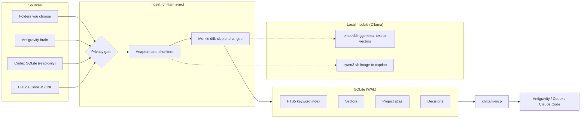
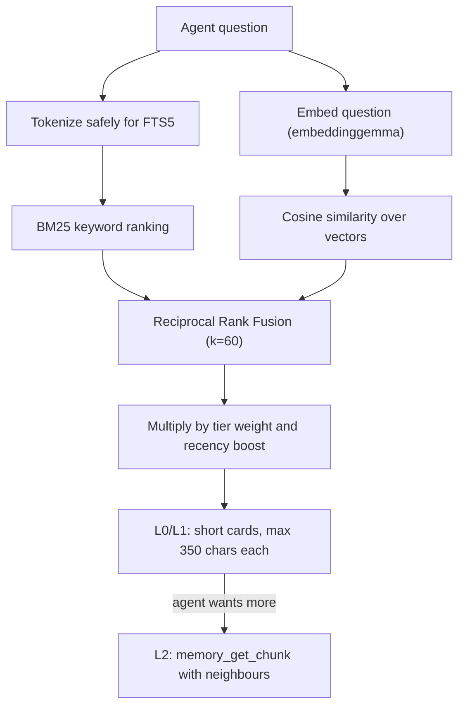

# Architecture

This page explains how Chittam works, in plain language first and then in more detail.

- [1. The five problems](#1-the-five-problems)
- [2. Big picture](#2-big-picture)
- [3. Ingestion: from files to chunks](#3-ingestion-from-files-to-chunks)
- [4. Retrieval: from a question to an answer](#4-retrieval-from-a-question-to-an-answer)
- [5. Privacy gate](#5-privacy-gate)
- [6. Canonical project atlas](#6-canonical-project-atlas)
- [7. Decision history (bitemporal)](#7-decision-history-bitemporal)
- [8. Storage layout](#8-storage-layout)
- [9. Models and providers](#9-models-and-providers)
- [10. Agent integration](#10-agent-integration)
- [11. Extending to new media types](#11-extending-to-new-media-types)
- [12. Module map](#12-module-map)
- [13. Known limits](#13-known-limits)

---

## 1. The five problems

| # | Problem | Chittam's answer |
| :- | :--- | :--- |
| 1 | **Cross-agent amnesia.** Each agent keeps its own history, so none of them knows what the others did. | Adapters read Antigravity, Codex, and Claude Code histories into one index. |
| 2 | **Multi-generation clutter.** Real machines hold `app`, `app-old`, `app-backup`, and `app-nov20`. | A project atlas classifies every repo as active, reference, or archive and ranks accordingly. |
| 3 | **Prompt-cache damage.** Memory tools that inject context on every turn change the prompt prefix and waste tokens. | Pull-only MCP: agents ask when they need something and get short summaries first. |
| 4 | **Multimodal blindness.** Diagrams, screenshots, and scanned PDFs are invisible to text search. | A local vision model captions images, so they become searchable text. |
| 5 | **Leaks.** Naive indexers read `.env` files, keys, and personal documents. | A privacy gate runs *before* any file is opened, and secrets are scrubbed from text. |

## 2. Big picture



Everything runs locally. The only network calls go to Ollama on `127.0.0.1`, plus external APIs if you explicitly enable them ([section 9](#9-models-and-providers)).

## 3. Ingestion: from files to chunks

`chittam sync` runs these steps:

1. **Lock.** It takes an exclusive file lock (`~/.local/share/chittam/sync.lock`). If a scheduled sync is already running, a manual sync exits instead of fighting it for the database.
2. **Atlas.** It loads the project atlas (or rebuilds it with `--refresh-atlas`).
3. **Collect.** Each adapter produces `DocumentRecord`s:
   - `files`: walks `scan_roots`. For the home folder itself (`~`) it only reads top-level files, never subfolders.
   - `antigravity`: markdown artifacts and user/assistant turns from `~/.gemini/antigravity/brain/*/`.
   - `codex`: `thread_history_1.sqlite` and `memories_1.sqlite`, opened with `?mode=ro` so Codex is never locked.
   - `claude_code`: `~/.claude/projects/*/*.jsonl` and `~/.claude/history.jsonl`.
4. **Chunk.** Each file type gets its own chunker:
   - **Code** splits at function and class boundaries (Python, TS/JS, Dart, Rust, Go, Shell, Kotlin/Java/Swift, Ruby, PHP), then merges small neighbours up to about 1,200 characters.
   - **Markdown and transcripts** split at headings and paragraphs.
   - **PDFs** are split per page. Pages with almost no text are marked as possibly scanned.
   - **Images** become one chunk containing the vision caption.

   Every chunk starts with a **contextual header** such as `[project | tier | path | date]`, so a chunk keeps its context after being cut out of the file. This is a zero-cost version of Anthropic's *Contextual Retrieval* idea.
5. **Merkle diff.** Each document has a SHA-256 hash. If the hash and tier are unchanged since the last sync, it is skipped, so re-syncs only process what changed. Documents that disappeared are pruned (decisions are never pruned).
6. **Embed.** Chunks without a vector are embedded in batches of 32, in priority order: active before reference before archive, and images, then transcripts, then PDFs, then markdown, then code. `max_embed_chunks_per_sync` caps the work per run, so a huge first sync spreads over several scheduled runs.

**Budgets that keep the first run sane** (all configurable):

| Setting | Default | Why |
| :--- | :--- | :--- |
| `max_images_per_sync` | 15 | Vision captioning takes about 1 to 17 seconds per image |
| `max_embed_chunks_per_sync` | 6000 | Embedding runs at roughly 20 to 60 chunks per second on Apple Silicon |
| `max_code_files_per_repo` | 250 (15 for archived repos) | Old snapshots shouldn't dominate the index |
| `max_text_file_bytes` | 512 KB | Skips generated or minified blobs |
| `max_pdf_pages` | 40 | Long PDFs are truncated |

## 4. Retrieval: from a question to an answer



- **Why hybrid?** Keyword search finds exact names (`AuthService`, an error string). Vector search finds meaning ("where do we retry logins?"). Each misses things the other catches.
- **Reciprocal Rank Fusion** combines the two rankings without tuning: `score = Σ 1/(60 + rank)`.
- **Tier weight** is `active` × 1.0, `reference` × 0.65, `archive` × 0.25.
- **Recency boost** is `1 + 0.15 · e^(−age_days/30)`: up to +15% for brand-new content, fading over a few months.
- **Progressive disclosure.** Search returns short cards (title, path, tier, a snippet of up to 350 characters). The agent fetches full text only for the hit it cares about. This keeps agent context small.
- **Query safety.** User text is stripped of FTS5 operators before matching, so queries like `C++ v14.2/beta?x=1` never crash.

## 5. Privacy gate

`is_path_excluded()` runs on every directory and file **before** it is opened, and again on the resolved target of a symlink.

| Layer | Default examples |
| :--- | :--- |
| Path globs | `~/tax/**`, `~/taxes/**`, `~/Library/**`, `~/.ssh/**`, `~/.aws/**`, `~/.gnupg/**`, `~/.kube/**`, agent OAuth files |
| Folder names (anywhere) | `.git`, `node_modules`, `.venv`, `build`, `dist`, `tax`, `taxes`, … |
| File patterns | `.env*`, `*.pem`, `*.key`, `id_rsa*`, `*credentials*`, `*secret*`, `auth.json`, `oauth_creds.json`, `google-services.json`, … |
| Hard guards | `/.ssh/`, `/.aws/`, `/.gnupg/`, `/tax/`, `/taxes/` are blocked even if you edit the config |

Text that does get indexed then goes through `redact_secrets()`, which replaces GitHub tokens, `sk-` keys, Google `AIza` keys, AWS access keys, PEM private keys, and `password=`/`api_key=` style assignments with `[REDACTED_*]`.

The benchmark includes negative queries that fail if any excluded path appears in results.

## 6. Canonical project atlas

`chittam atlas --refresh` walks `scan_roots` (up to depth 4) and records every git repo in `~/.config/chittam/canonical-projects.yaml`:

| Tier | Rule |
| :--- | :--- |
| `active` | Last commit within 45 days, and the path doesn't look like a copy |
| `reference` | Last commit 46 to 180 days ago |
| `archive` | Older than 180 days, **or** the path contains `archive`, `backup`, `old`, `copy`, `legacy`, `snapshot`, or month-dated snapshot names |

- Repos are grouped into **families** by stripping suffixes, so `app_old`, `75_app`, and `appNov20` all belong to family `app`.
- When two repos share a name, the plain project id goes to the higher tier, then to the repo under the earlier `scan_roots` entry, then to the most recent commit. The others get a suffix based on their parent folder, such as `app--archives`.
- Set `manual_override: true` on any entry to pin its tier. Your pin survives future refreshes.

Every document inherits its repo's tier, which is how "the current copy wins" works at query time.

## 7. Decision history (bitemporal)

Decisions are stored with validity windows:

```text
decision_id | project | topic   | statement                | valid_from | valid_to   | superseded_by
dec_a1      | app     | storage | "Use SQLite"             | 2026-03-01 | 2026-06-10 | dec_b2
dec_b2      | app     | storage | "Use Postgres for sync"  | 2026-06-10 | (null)     |
```

Recording a new decision on the same `(project, topic)` closes the previous one instead of deleting it. Agents see the current rule by default and can still ask why it changed. This is a lightweight take on the temporal knowledge-graph idea from [Zep/Graphiti](https://arxiv.org/abs/2501.13956).

## 8. Storage layout

Everything is one SQLite file in WAL mode at `~/.local/share/chittam/memory.db`:

| Table | Holds |
| :--- | :--- |
| `documents` | One row per source: uri, harness, media type, project, tier, title, summary, sha256, updated_at |
| `chunks` | Chunk text, contextual header, symbol name, line range |
| `chunks_fts` | FTS5 index over header, content, title, project, harness |
| `chunk_embeddings` | L2-normalised float32 vectors (model, dimension) |
| `image_cache` | Vision captions keyed by image SHA-256, so an image is never captioned twice |
| `decisions` | Bitemporal decision log |

No Docker and no separate vector database. Backup is copying one file.

## 9. Models and providers

| Role | Default (local) | Notes |
| :--- | :--- | :--- |
| Text embeddings | `embeddinggemma:latest` (768-d) | Optional Matryoshka truncation, always re-normalised |
| Vision | `qwen3-vl:2b` | Images resized to ≤1024 px, context capped at 8K tokens to avoid memory spikes |
| Reranker | none | `RerankProvider` interface exists for future use |

External providers (OpenAI-compatible, Gemini, or Ollama on another machine) sit behind the same interfaces. They raise `ConsentRequiredError` unless **both** `external_provider.enabled` **and** `external_provider.user_consented` are `true` and the API key environment variable is set. See [HOW_TO §7](HOW_TO.md#7-opt-in-to-cloud-models-or-a-remote-ollama-server).

## 10. Agent integration

`chittam install-harnesses`:

1. Backs up each config (`0600` permissions) to `~/.local/share/chittam/backups/` and writes a `manifest.json`.
2. Adds `chittam` (and `codegraph`, if installed) to:
   - Antigravity: `~/.gemini/config/mcp_config.json`
   - Codex: `~/.codex/config.toml` (TOML edited in place, comments preserved)
   - Claude Code: `~/.claude.json` (all other keys preserved)
3. Re-parses each file. If parsing fails, it restores the backup immediately.

Running it twice changes nothing. `uninstall-harnesses` removes only the entries Chittam added.

The [routing rule](ROUTING_RULE.md) tells agents: use `ripgrep` for known names in the current repo, CodeGraph for call graphs, and Chittam for everything cross-repo, conceptual, visual, or historical.

## 11. Extending to new media types

File handling goes through a registry, so audio and video can be added without touching the core:

```python
from chittam.adapters.files import register_media_handler
from chittam.models import MediaType

def handle_audio(path, ctx):
    transcript = my_local_whisper(path)          # your code
    ...                                          # return a DocumentRecord

register_media_handler(MediaType.AUDIO, {".wav", ".mp3", ".m4a"}, handle_audio)
```

`MediaType.AUDIO` and `MediaType.VIDEO` already exist in the data model. Add them to `privacy.enabled_media` to switch them on.

## 12. Module map

```text
src/chittam/
  models.py        Pydantic contracts (config, documents, chunks, results, decisions)
  config.py        Config loading, privacy gate, secret redaction
  atlas.py         Repo discovery, tiering, families, YAML persistence
  adapters/
    __init__.py    Chunkers + collect_all_documents()
    files.py       Folders, code, markdown, PDF, images, media registry
    antigravity.py Antigravity brain artifacts and transcripts
    codex.py       Codex SQLite (read-only) and memory files
    claude_code.py Claude Code JSONL sessions and history
  providers.py     Ollama + consent-gated external embedding/vision providers
  store.py         SQLite schema, hybrid search, decisions, stats
  indexer.py       sync_memory(): lock, collect, diff, embed, LEANN export
  mcp_server.py    Six pull-only MCP tools over stdio
  harnesses.py     Reversible Antigravity / Codex / Claude Code wiring
  launchd.py       macOS scheduled sync
  benchmark.py     Synthetic + custom benchmarks
  cli.py           `chittam` command
```

## 13. Known limits

These are honest constraints of v0.1:

- **Vector search is brute force** (numpy over all stored vectors). It's fast up to roughly 100k vectors. Beyond that, query latency grows linearly. Export to LEANN, or contribute an ANN index (USearch/HNSW).
- **Not every chunk gets a vector on the first run.** The per-sync embedding budget means large machines fill in vectors over several scheduled runs. Until then, those chunks are findable by keyword only.
- **First sync on a large machine is slow.** About 30k documents took roughly 2 hours on an M4 Pro, mostly embedding and captioning. Later syncs are incremental.
- **Loose notes rank lower than project files**, because files outside a git repo get the `reference` weight (0.65). Pin a folder as a repo or adjust weights if that hurts you.
- **No reranker yet.** Top-5 precision would improve with a cross-encoder.
- **Queries always use the local embedding model.** Embedding the corpus with an external model of a different dimension silently falls back to keyword-only search.
- **macOS privacy (TCC)** may block `~/Desktop`, `~/Documents`, or `~/Downloads` for background jobs until you grant access.
- **Scheduled sync is macOS-only** (launchd). On Linux, use cron or a systemd timer ([HOW_TO §5](HOW_TO.md#5-keep-the-index-fresh)).
